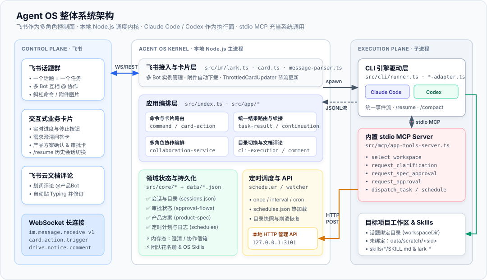

# Agent OS

把飞书话题群变成你的个人 AI 团队协作指挥台。

**Agent OS** 是一个基于 Node.js + TypeScript 的多角色 AI 调度系统：它在本地通过飞书 WebSocket 长连接接入多个角色机器人，统一驱动本机的 **Claude Code** 与 **Codex CLI** 执行研发、文档与运维任务，并在关键节点通过飞书交互卡片实现「人在回路（Human-in-the-Loop）」协作。

> 📖 **想结合源码深入学习或回顾架构？** 仓库内置了 8 章节的 **Docsify 源码学习手册**（位于 [`docs/`](docs/README.md)），支持本地预览及直接通过 GitHub Pages 发布：
> - 本地预览：`python3 -m http.server -d docs 3000`（访问 `http://localhost:3000`）
> - 在线发布：在仓库 `Settings → Pages → Build and deployment` 选择 **Deploy from a branch** → **`main`** → **`/docs`** 即可自动上线。

---

## 核心定位

- **一个飞书话题 = 一个任务上下文**：在话题群里发起新话题即开启独立任务，同话题内的不同角色自动共享任务工作目录。
- **多角色各司其职**：通过配置文件组建团队（如 CEO 助理、产品经理、开发、审查、测试），由 Team Leader 拆解派单、成员执行并回传结果。
- **可控的交互式执行**：通过内置 MCP Server 接管模型的关键控制动作（选目录、澄清问题、提交方案、高危审批、派发任务、定时调度），在需要人拍板时暂停 CLI 进程并发送飞书卡片，待发起人确认后自动续接上下文。

---

## 核心能力

### 1. 多角色团队与协作编排
- 支持同时运行多个飞书 Bot，每个 Bot 绑定独立的角色设定、系统提示词、默认 CLI 引擎和 Skill 集合。
- 指定一名 `teamLeader`（默认 `ceo-assistant`）负责理解目标、调用 `dispatch_task` 将任务确定性派发给其他成员，并汇总团队最终结论。
- 协作派单自动携带工作目录、任务发起人与轮次上限（`collaborationMaxRounds`，默认 16 轮），防止无限循环或跨项目串味。

### 2. 双 AI CLI 引擎适配
- 原生适配 **Claude Code**（`claude`）与 **Codex**（`codex`），统一流式解析工具调用、思考进度、Token 统计与最终结果。
- 支持为每个角色配置 `defaultCli`，也可在新话题中通过 `/claude <任务>` 或 `/codex <任务>` 临时指定引擎。
- 支持实时更新飞书进度卡片、随时点击卡片中止运行、`/resume` 恢复该目录下的原生 CLI 会话、`/compact` 触发引擎原生上下文压缩。
- 自动下载飞书消息中的图片与文件附件并传递给执行引擎。

### 3. 人在回路（飞书交互卡片）
当模型调用以下控制工具时，Agent OS 会立即停止当前 CLI 进程并转为等待状态，推送交互卡片给**任务发起人**（仅发起人可操作）：
- **需求澄清卡片**（`request_clarification`）：支持一次最多 5 个问题（每题 2~4 个选项，亦支持自由回复），收集答案后自动续接执行。
- **产品方案确认卡片**（`request_spec_approval`）：支持本地 Markdown（`spec.md` + `issues`）或飞书云文档（`lark-doc`）两种唯一权威产物模式；支持监听飞书云文档评论（`drive.notice.comment_add_v1`）按评论自动修订方案；用户点击确认后自动回传给 Team Leader 推进开发。
- **高危操作审批卡片**（`request_approval`）：涉及重启服务、删文件、写库等高危操作时展示操作详情、影响范围与回滚方案，默认 300 秒超时自动拒绝（服务重启后自动恢复计时）。

### 4. 话题级工作目录管理
- 新话题默认**不绑定项目目录**，可直接讨论需求；进入具体项目前再由对话指定（模型调用 `select_workspace`）或通过 `/cd <目录>` 绑定。
- 同一群同一话题内所有角色共享工作目录，新话题独立隔离，彻底避免多任务互相覆盖。

### 5. 定时任务调度
- 支持 **一次性（`once`）**、**固定间隔（`interval`）** 和 **Cron 表达式（`cron`，默认 `Asia/Shanghai`）** 三种调度规则。
- 支持在飞书直接用自然语言 `/schedule <需求>` 创建计划、用斜杠命令管理、通过本地 HTTP API 管理，或直接编辑 `data/schedules.json` 触发热加载。
- 定时任务创建时自动快照当前话题的 `workspaceDir`，后续话题切换目录不会影响既有计划。

---

## 系统架构与目录结构



主要目录说明：

```text
.
├── config/
│   └── bots.example.json       # 多角色团队配置示例
├── docs/                       # Docsify 源码学习 Wiki（8 章架构与源码导读）
├── skills/                     # OS 自有工作流 Skill
│   ├── grill-me/SKILL.md       # 需求澄清（驱动 request_clarification）
│   ├── to-spec/SKILL.md        # 产出本地产品 Spec
│   ├── to-tickets/SKILL.md     # 拆分可独立验收的纵向切片 Tickets
│   └── implement-ticket/SKILL.md # 按确认方案实现并串联测试/审查验证
├── src/
│   ├── index.ts                # 主服务入口
│   ├── deploy-cli.ts           # 本地运维 CLI（agent-os doctor/start/...）
│   ├── im/                     # 飞书 WebSocket/REST 封装、消息解析、卡片构建
│   ├── cli/                    # Claude / Codex 适配器、进程管理、原生会话与压缩
│   ├── mcp/                    # 向 AI CLI 暴露的 stdio MCP Server
│   ├── core/                   # 领域模型与 JSON 持久化（会话/审批/方案/定时/目录）
│   └── app/                    # 应用编排（命令处理/卡片回调/协作/续接/定时调度与 API）
└── tests/                      # 离线自动化回归测试（Mock CLI & 飞书）
```

---

## 快速开始

### 1. 环境准备

- **Node.js 22+** 与 **pnpm**（仓库声明 `pnpm@10.30.3`）
- 本机已安装并完成认证的 **`claude`**（Claude Code）和/或 **`codex`**（Codex CLI）
- **PM2**（`npm install -g pm2`，用于本地生产常驻运行）
- 飞书自建应用（按你实际启用的角色数量准备对应的 `App ID` 与 `App Secret`）

### 2. 配置飞书应用

在飞书开放平台为每个启用的角色创建自建应用：
1. 开启**机器人**能力。
2. 事件与回调选择**使用长连接接收事件（WebSocket）**，并订阅：
   - `im.message.receive_v1`（接收消息）
   - `card.action.trigger`（卡片交互回调）
   - `drive.notice.comment_add_v1`（可选：仅启用 `lark-drive` 云文档评论修订的角色需要）
3. 配置对应的消息收发、群组、卡片（及可选的云文档/评论）权限，发布应用并将机器人拉入飞书话题群。

### 3. 安装与初始化配置

```sh
pnpm install
cp .env.example .env
cp config/bots.example.json config/bots.json
```

编辑 `.env` 与 `config/bots.json`：
- 在 `.env` 中填入对应角色的飞书 `APP_ID` / `APP_SECRET` 和你自己的 `OWNER_OPEN_ID`（跑通首条消息后可从日志 `sender=` 字段获取）。
- 在 `config/bots.json` 中只启用你实际需要的角色（未使用的角色可删掉或设置 `"enabled": false`），并确保所绑定 Skill 已准备就绪。

> **注意**：`config/bots.example.json` 中引用的 `code-review-expert`、`verify` 等第三方 Skill 以及飞书 `lark-doc` / `lark-drive` Skill 不在仓库内，如启用对应角色请先自行安装；不需要可从对应角色的 `skills` 数组中移除。

### 4. 检查环境、构建并启动

```sh
pnpm build
pnpm test
pnpm agent-os doctor
```

选择启动方式：

```sh
# 开发模式（监听源码、.env 与 config/*.json 自动重启）
pnpm dev

# 单次前台运行
pnpm start:once

# 本地生产常驻（通过 PM2 运行编译产物 dist/index.js）
pnpm agent-os start
```

> 修改代码后，生产常驻模式需先执行 `pnpm build`，再执行 `pnpm agent-os restart`。

---

## 配置说明

### 环境变量（`.env`）

| 变量名 | 必填 | 默认值 | 说明 |
| --- | --- | --- | --- |
| `BOTS_CONFIG` | 否 | `config/bots.json` | 角色配置文件路径，相对路径基于 OS 根目录解析 |
| `FEISHU_*_APP_ID` / `FEISHU_*_APP_SECRET` | 是 | - | 具体变量名由 `bots.json` 中各角色的 `appIdEnv` / `appSecretEnv` 指定 |
| `OWNER_OPEN_ID` | 推荐 | - | 你的飞书 `open_id`，用于外部 Bot 派活场景下确定任务归属人 |
| `AGENT_OS_DATA_DIR` | 否 | `data` | 运行数据存储目录（会话、审批、方案、定时任务等），相对路径基于 OS 根目录 |
| `SCHEDULE_API_PORT` | 否 | `3101` | 本地定时任务管理 HTTP API 监听端口（仅监听 `127.0.0.1`） |
| `SCHEDULE_API_TOKEN` | 否 | 无 | 本地定时任务管理 API 的鉴权请求头 `x-api-token`（未设置时不鉴权） |
| `CLI_TIMEOUT_MS` | 否 | `7200000` (2h) | 默认 CLI 执行超时时间（毫秒）；也可单独设置 `CLAUDE_TIMEOUT_MS` / `CODEX_TIMEOUT_MS` |
| `CLAUDE_CONFIG_DIR` | 否 | `~/.claude` | Claude Code 原生会话扫描目录（用于 `/resume`） |

### 角色配置（`config/bots.json`）

顶层字段：
- `teamLeader`：Team Leader 的角色 `id`（必须指向已启用的角色，只有它可以在运行时调用 `dispatch_task`）。
- `defaultProductDeliveryMode`：产品方案默认交付方式，可选 `"lark-doc"`（默认，飞书云文档）或 `"local"`（本地 Markdown）。
- `bots`：角色列表，每个角色支持以下字段：
  - `id`：唯一标识（小写字母、数字、`-`、`_`）
  - `appIdEnv` / `appSecretEnv`：对应 `.env` 中的飞书凭证环境变量名
  - `defaultCli`：默认执行引擎，`"claude"` 或 `"codex"`
  - `role`：角色职责描述
  - `skills`：绑定的 Skill 名称列表
  - `systemPrompt`：角色系统提示词
  - `collaborationMaxRounds`：协作最大轮次（`1~32`，默认 `16`）
  - `enabled`：是否启用（默认 `true`）

### 服务路径与 Skill 规则

OS 根目录由程序文件位置自动确定，与启动时的当前工作目录（cwd）无关：
- `.env`、默认 `config/bots.json`、`skills/` 均相对于 OS 根目录解析。
- OS 自有 Skill 读取 `skills/<name>/SKILL.md`；Skill 内部引用的脚本或资源相对于 Skill 目录解析，交付产物写入任务工作目录。
- 飞书 `lark-*` Skill 由执行引擎（Claude Code / Codex）中已安装的包提供，OS 不复制、不解析其路径，也不检查安装状态。
- 部署时请保留 `dist/`、`skills/`、配置文件和 `node_modules` 之间的相对目录结构，不要只单独复制 `dist/index.js`。

---

## 使用指南

### 飞书斜杠命令

在话题中 @ 对应机器人发送以下命令：

| 命令 | 说明 |
| --- | --- |
| `/help` | 查看全部可用命令 |
| `/status` | 查看当前话题会话状态、引擎、工作目录与上下文信息 |
| `/team` | 以卡片查看当前已注册的 AI 团队成员、角色、引擎、Skill 与就绪状态 |
| `/cd` | 查看当前话题绑定的工作目录 |
| `/cd <目录>` | 绑定或切换当前话题的工作目录（支持绝对路径、`~` 路径及已绑定目录下的相对路径） |
| `/claude <任务>` | 在新话题中指定使用 Claude Code 执行任务 |
| `/codex <任务>` | 在新话题中指定使用 Codex 执行任务 |
| `/new` | 清空当前 CLI 会话绑定，下一条消息开启全新会话（旧会话可用 `/resume` 找回） |
| `/resume` | 列出当前工作目录下的原生 CLI 历史会话，通过卡片切换恢复 |
| `/compact [要求]` | 调用当前引擎原生能力整理压缩上下文 |
| `/schedule <需求>` | 用自然语言让机器人创建定时任务（如 `/schedule 每小时检查一次服务日志`） |
| `/schedules` | 以卡片列出全部定时任务 |
| `/schedule pause <id>` | 暂停指定定时任务 |
| `/schedule resume <id>` | 恢复指定定时任务 |
| `/schedule delete <id>` | 删除指定定时任务 |
| `/schedule run <id>` | 立即手动触发一次定时任务 |
| `/close` | 中止正在执行的任务并关闭当前话题会话 |

### 工作目录绑定规则

- **先讨论、后绑定**：新话题默认不绑定项目目录；需要读写项目或生成本地产物时，再明确指定目录。
- **两种绑定方式**：
  1. 在对话中直接说出路径，模型调用 `select_workspace`，OS 验证目录后自动重建 CLI 会话继续任务；
  2. 直接发送 `/cd /absolute/project` 或 `/cd ~/Code/project` 选择已有目录。
- **相对路径与新建目录**：相对路径仅基于当前话题已绑定目录解析；新建不存在的目录需要用户明确表达新建意图，由工具携带 `create: true` 提交。
- **共享与隔离**：同一群同一话题内所有角色共享目录，协作任务自动继承目录；切换目录会清除该话题下各角色的 CLI 会话绑定（保留有限文字交接），避免旧上下文污染。
- **忙碌保护**：同话题内任一成员正在执行，或存在待处理审批、产品确认、澄清时，禁止切换目录；请先处理完或另开话题。
- **已弃用配置**：旧 `bots[].workspace`、`CLI_WORKDIR`、`CLAUDE_WORKDIR` 已弃用，不再为新话题设置默认目录。历史会话若存在目录冲突或缺少有效绝对路径，启动时会自动转为未绑定状态并使相关未处理审批/方案失效。

### 内置 MCP 工具（供模型调用）

Agent OS 在启动 CLI 子进程时自动注入名为 `agent_os` 的 stdio MCP Server，提供以下工具：

| 工具名 | 作用 |
| --- | --- |
| `select_workspace` | 绑定或切换当前话题的工作目录并自动续接 |
| `request_clarification` | 发送飞书需求澄清问答卡片并等待用户回复 |
| `request_spec_approval` | 提交唯一产品方案（本地 Spec+Tickets 或飞书云文档）供用户确认 |
| `request_approval` | 发起高危操作审批卡片并等待用户拍板 |
| `dispatch_task` | 将任务派发给团队其他角色（仅 `teamLeader` 可调用） |
| `schedule_manage` | 统一增删改查、暂停/恢复、立即执行与查看定时任务日志 |

### 定时任务管理 API 与迁移

服务启动后会监听本地管理接口（默认 `http://127.0.0.1:3101`，如配置了 `SCHEDULE_API_TOKEN` 需携带请求头 `x-api-token`）：

- `GET /api/schedules`：获取全部定时任务
- `POST /api/schedules`：创建定时任务（必须显式传入绝对路径 `workspaceDir`；纯讨论任务可显式传空字符串 `""`）
- `PATCH /api/schedules/:id`：暂停/恢复（请求体 `{"action": "pause" | "resume"}`）
- `DELETE /api/schedules/:id`：删除任务
- `POST /api/schedules/:id/run`：立即执行一次
- `GET /api/schedules/:id/runs`：查看执行记录

**旧定时任务迁移**：如果 `data/schedules.json` 中存在未配置 `workspaceDir` 的历史计划，启动后会自动暂停。确认目录后，可直接在 `data/schedules.json` 中补上 `workspaceDir` 并将 `status` 改为 `"active"`，文件监听会自动热加载生效。

### 本地运维与诊断命令

```sh
pnpm agent-os doctor    # 检查 node / pnpm / pm2 / claude / codex 与配置文件
pnpm agent-os start     # 构建（若缺失 dist）并通过 PM2 启动或重启 agent-os
pnpm agent-os restart   # 重启 PM2 进程
pnpm agent-os stop      # 停止 PM2 进程
pnpm agent-os status    # 查看 PM2 状态
pnpm agent-os logs      # 查看运行日志

pnpm probe:cli          # 独立探测本地 CLI 引擎输出是否正常
pnpm probe:tool         # 独立探测内置 MCP 工具调用链路
```

---

## 验证与已知限制

### 自动化测试

运行 `pnpm test` 执行本地回归测试（位于 `tests/workspace.test.ts` 与 `tests/chains.test.ts`）：
- 使用临时目录、模拟 CLI 子进程与真实 MCP 子进程（对接本地定时任务管理 API），不连接真实飞书，也不消耗真实模型额度。
- 覆盖目录绑定与共享、旧配置迁移、重启恢复、忙碌保护、Skill 路径解析、双引擎工具识别、目录切换后自动续接、首轮/澄清/审批续接与定时任务目录快照。
- 本地测试不能替代线上飞书事件、真实 CLI 协议升级和真实模型输出行为的联调验收。

### 当前已知边界与限制

1. **部分临时流程未持久化**：会话（`sessions.json`）、产品方案（`product-spec-flows.json`）、审批（`approval-flows.json`，含重启恢复超时计时）与定时任务（`schedules.json` / `schedule-runs.json`）均已持久化；但**需求澄清流程**和**待接收协作队列**目前仅保存在内存中，服务重启后无法自动恢复。
2. **定时任务仅支持直接执行模式**：定时任务执行过程中不支持中途进入审批、澄清、产品确认或团队派发；遇到这类请求会直接记录执行失败，不会误报成功。
3. **无文件系统级沙箱**：话题未绑定工作目录时，CLI 在 `data/scratch/` 下的独立临时目录运行，并通过执行提示词约束禁止读写项目文件；这不构成操作系统级文件系统沙箱，CLI 仍沿用其原有权限模式。
