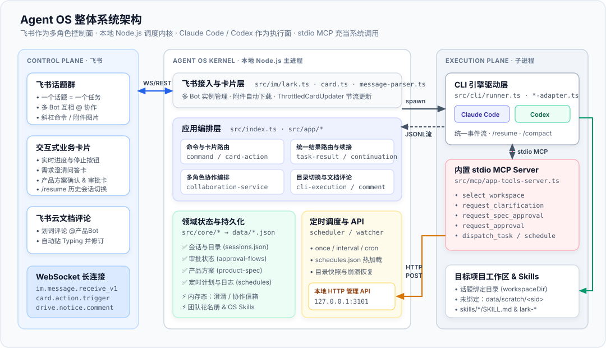
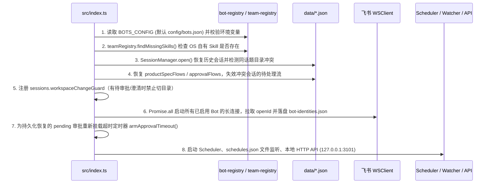

# 01. 整体架构与启动全流程

> **本章目标**：理解 Agent OS 的 5 层代码划分、核心运行时对象 `AppRuntime` 里装了什么，以及执行 `pnpm start` 后 `src/index.ts` 按什么顺序把整个系统拉起来。

> **用大白话理解**：你可以把 Agent OS 想象成一家“线上软件公司”的总控前台——飞书群是办公大厅，你挂在群里的多个机器人是不同岗位的员工（CEO 助理、产品、开发、测试），本机跑的 `claude` / `codex` CLI 是员工电脑上的 IDE，而 Agent OS 就是负责接电话、派工单、管文件夹、收审批的“办公室调度系统”。

---

## 1. 为什么这样分层？

Agent OS 的复杂度并不在“调一次大模型”，而在于要同时协调 **多机器人飞书事件 + 长周期 CLI 子进程 + 可暂停/续接的人工交互 + 跨进程 MCP 控制 + 定时调度**。

为了避免业务状态、飞书 SDK 和子进程协议纠缠在一起，源码按依赖方向分为 5 层：



各层职责边界非常清晰：
- **`src/core/`**：不依赖飞书 SDK，也不直接 spawn CLI。负责配置解析（`bot-registry.ts`）、会话状态机（`session-manager.ts`）、审批/澄清/产品方案/定时任务的数据结构、Zod Schema 校验与 JSON 落盘。
- **`src/im/`**：屏蔽飞书 `@larksuiteoapi/node-sdk` 细节。负责建立 WebSocket 长连接、解析 `@` 提及和图片/文件附件、构建各类卡片 JSON，以及通过 `ThrottledCardUpdater` 防止高频刷新触发飞书限流。
- **`src/cli/`**：屏蔽 `claude` 与 `codex` 两个 CLI 的命令行参数与流式 JSON 协议差异，向外统一输出 `CliEvent` 与 `CliRunResult`。
- **`src/mcp/`**：作为独立 Node 子进程由 Claude / Codex 拉起，通过 stdio 暴露 `agent_os` 工具集。
- **`src/app/`**：把上面几层串成完整业务流（命令路由、任务续接、协作派单、卡片按钮回调、云文档评论修订、定时任务调度器与本地 HTTP API）。

---

## 2. 路径锚定：为什么不受启动 cwd 影响？

先看全仓最短但最基础的文件 `src/core/paths.ts`：

```ts
export const OS_ROOT = fileURLToPath(new URL('../../', import.meta.url));
config({ path: resolve(OS_ROOT, '.env'), quiet: true });
export const DATA_ROOT = resolve(OS_ROOT, process.env.AGENT_OS_DATA_DIR ?? 'data');
export const SKILLS_ROOT = resolve(OS_ROOT, 'skills');
```

**设计动机**：
- 无论你是在项目根目录跑 `pnpm start`，还是 PM2 从任意目录启动 `node /path/to/dist/index.js`，甚至子进程在别的项目目录启动 MCP Server，`OS_ROOT` 永远以代码自身位置（`import.meta.url` 向上两级）为锚点。
- 因此 `.env`、`config/bots.json`、`skills/`、`data/` 的定位永远稳定，不会因为当前工作目录变化而读错配置或把数据写进用户项目目录里。

---

## 3. 核心状态容器：`AppRuntime`

在 `src/app/runtime.ts` 与 `src/index.ts`（第 80–115 行）中，整个服务共享一份 `AppRuntime` 对象，里面存放了两类状态——**持久化状态**与**纯内存态**：

| 字段 | 类型 / 存储文件 | 是否持久化 | 用途 |
| --- | --- | --- | --- |
| `sessions` | `SessionManager` → `data/sessions.json` | ✅ 是 | 每个 `(botId, chatId, threadId)` 的会话状态、工作目录与原生 `cliSessionId` |
| `productSpecFlows` | `JsonProductSpecFlowStore` → `data/product-spec-flows.json` | ✅ 是 | 待确认的产品方案（含云文档 URL / 本地路径），用于卡片确认和文档评论关联 |
| `approvalFlows` | `JsonApprovalFlowStore` → `data/approval-flows.json` | ✅ 是 | 待拍板的高危操作审批（含超时时间 `expiresAt`） |
| `teamRegistry` | `TeamRegistry`（源自 `config/bots.json`） | 配置文件 | 团队花名册、Team Leader ID、成员 Prompt 拼接 |
| `botRuntimes` | `Map<botId, BotRuntime>` | 内存（启动时写 `data/bot-identities.json`） | 已连接的飞书 Bot 实例及其 `openId` / `name` |
| `activeRuns` | `Map<sessionId, ActiveRun>` | ❌ 内存 | 正在执行的任务及其 `AbortController`（供停止按钮、`/close` 使用） |
| `contextWindows` | `Map<sessionId, number>` | ❌ 内存 | 缓存当前会话模型的上下文窗口上限（用于进度卡显示占用比例） |
| `clarificationFlows` | `ClarificationFlowStore` | ❌ 内存 | 等待用户回答的澄清问题卡片流 |
| `collaborationInbox` | `CollaborationInbox` | ❌ 内存 | 已派发、等待目标 Bot 消费的协作任务信箱 |
| `processedCollaborationTurns` | `Set<string>` | ❌ 内存 | 已处理协作轮次去重表 |

> **关键记忆点**：这就是 README 里提到的边界来源——`sessions`、`productSpecFlows`、`approvalFlows`、`schedules` 都有对应的 `Json*Store` 落盘，而 `clarificationFlows` 和 `collaborationInbox` 目前是纯内存结构，服务重启后会清空。

---

## 4. 启动全流程（跟着 `src/index.ts` 走一遍）

从上到下阅读 `src/index.ts`，启动过程非常线性，一共 8 个阶段：



### 容易忽略的 4 个启动细节

1. **启动即快速失败（Fail Fast）**（`src/index.ts:76-79`）
   - 如果 `config/bots.json` 里某个角色绑定了非 `lark-` 开头的 Skill，但 `skills/<name>/SKILL.md` 不存在，服务启动时会直接抛错退出，避免跑到一半才发现 Skill 缺失。
2. **历史目录冲突自愈**（`src/index.ts:98-99`、`src/core/session-manager.ts:78-90`）
   - `SessionManager.open()` 恢复历史会话时，会按 `(chatId, threadId)` 分组检查：如果同一话题下不同 Bot 曾绑定过不同的 `workspaceDir`，会把该话题全部会话重置为未绑定（`workspaceDir = ''`）、清除 `cliSessionId`、标记 `workspaceConflict = true`。
   - 紧接着 `approvalFlows.invalidateWorkspaceSessions(...)` 和 `productSpecFlows.invalidateWorkspaceSessions(...)` 会让这些冲突会话里遗留的待审批/待确认流程失效，防止旧目录上下文误操作新目录。
3. **重启后恢复审批超时计时**（`src/index.ts:746-749`）
   - 所有 Bot 就绪后，会遍历 `approvalFlows.pending()`，调用 `armApprovalTimeout(...)`。如果重启期间审批已经超过 `expiresAt`，`Math.max(0, expiresAt - now)` 会立刻触发超时自动拒绝并续接会话告知模型。
4. **文档评论订阅按需开启**（`src/index.ts:174-180, 638-647`）
   - 只有 `skills` 中包含 `lark-drive` 的角色，才会注册 `onDocumentComment` 回调并在启动后调用 `subscribeToDocumentComments()`。

---

## 5. 以后想改哪里？

- **调整启动顺序或新增后台服务**：看 `src/index.ts` 尾部（第 742–759 行）。
- **新增配置字段或环境变量校验**：看 `src/core/bot-registry.ts` 的 `BotSchema` 和 `BotConfigFileSchema`。
- **给某个内存状态补持久化**：参考 `src/core/approval-store.ts` 包装一层 `Json*Store`，在 `src/index.ts` 初始化处替换即可。
