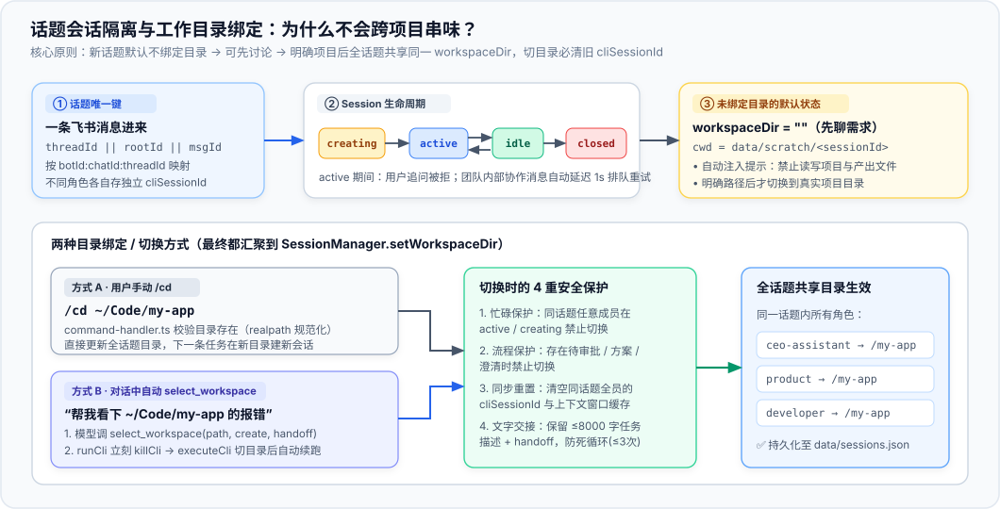
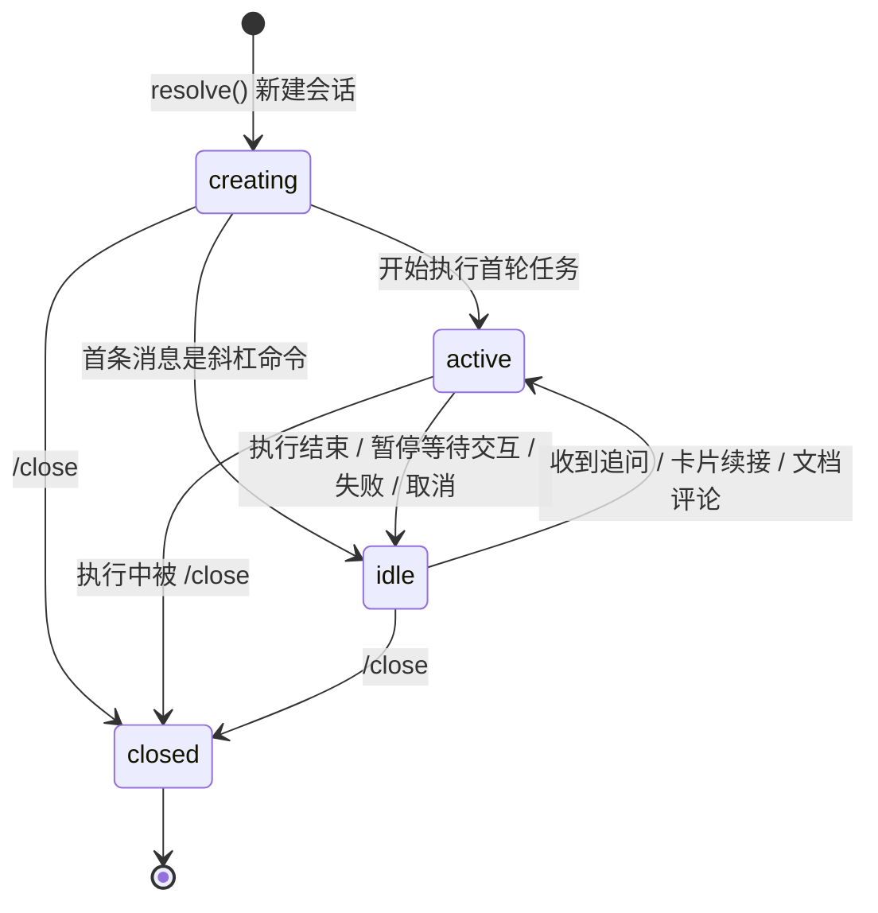
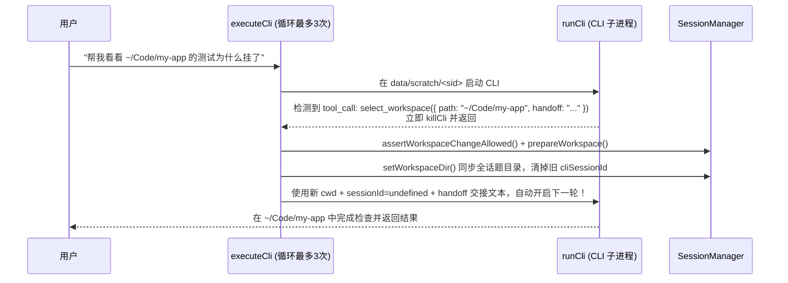

# 02. 飞书接入、话题会话与工作目录

> **本章目标**：搞清楚一条飞书消息从进来到开始执行 CLI 经历了什么，一个话题如何映射为 Session，以及「话题级共享工作目录」和 `select_workspace` 自动切换是怎么实现的。

> **用大白话理解**：每个飞书话题就像一间独立会议室。大家刚进会议室时，桌上什么代码仓库都没放（未绑定目录），先纯聊需求；等确定要改哪个项目后（发 `/cd` 或聊天提到路径），会议室门牌挂上这个项目目录，所有进这间会议室的机器人自动在同一个仓库里干活，但各自保留自己的笔记本（独立的 `cliSessionId`）。



---

## 1. 飞书接入层做了什么（`src/im/lark.ts`）

Agent OS 不需要公网域名或 Webhook 回调地址，而是为每个已启用角色建立独立的飞书 **WebSocket 长连接**（`Lark.WSClient`）。

在 `src/im/lark.ts:392-436` 中，每个 Bot 注册了三类事件：

| 飞书事件名 | 处理回调 | 用途 |
| --- | --- | --- |
| `im.message.receive_v1` | `onMessage` | 接收用户消息、斜杠命令、附件以及其他 Bot 的 `@` 协作通知 |
| `card.action.trigger` | `onCardAction` | 接收卡片按钮点击（确认方案、回答澄清、审批放行/拒绝、切换历史会话、停止任务） |
| `drive.notice.comment_add_v1` | `onDocumentComment` | 接收飞书云文档中 `@` 机器人的评论事件（仅绑定 `lark-drive` Skill 的角色监听） |

### 几个实用细节
- **消息长度保护**（`src/im/lark.ts:54-64`）：飞书单条消息有字数限制，封装了 `fitFeishuText`（普通文本上限 3000 字、协作 `@` 通知 1200 字、文档评论 1000 字）；而最终超长回答会由 `src/im/card.ts` 的 `answerNeedsContinuation` + `splitLongText` 拆成多条后续文本回复。
- **附件自动下载**（`src/index.ts:265-296`、`src/im/message-parser.ts:37-61`）：支持提取 `image`、`file` 以及富文本 `post` 中的嵌入图片，自动下载到 `data/downloads/<fileKey>.<ext>`，然后把本地绝对路径拼进 Prompt 末尾，让 Claude / Codex 直接读取。
- **卡片节流更新**（`src/im/card.ts` 的 `ThrottledCardUpdater`）：任务执行期间每秒心跳 + 工具开始/结束都会推进度，节流器避免把飞书 `updateCard` 接口打爆，并在最终 `finish(card)` 时保证终态卡片一定落上去。

---

## 2. 话题如何映射为 Session（`src/core/session-manager.ts`）

核心理念是 **「一个话题 × 一个角色 = 一个 Session」**。

在 `src/core/session-manager.ts:47-53` 中：

```ts
function topicIdOf(message: MessageAddress): string {
  return message.threadId || message.rootId || message.messageId;
}

function sessionKey(botId: string, chatId: string, threadId: string): string {
  return `${botId}:${chatId}:${threadId}`;
}
```

**解读**：
- 在飞书话题群里，一条话题下的所有回复共享同一个 `threadId`（或根消息 `rootId`）；如果是首条顶层消息还没有 `threadId`，则以 `messageId` 作为话题 ID。
- 同一个话题下，`ceo-assistant`、`product`、`developer` 各自拥有独立的 Session（因此各自维护独立的 `cliSessionId`，对话上下文不串台），但它们共享同一个 `(chatId, threadId)` 下的 `workspaceDir`。

### Session 状态机

`src/core/session-manager.ts:40-45` 定义了严格的状态流转表：



**关键防并发规则**（`src/index.ts:335-367`）：
- 如果 `session.status === 'active'`，普通用户追问会被礼貌拒绝（“当前会话还在执行，请等任务结束后再追问”）。
- 但如果是**团队内部协作消息**撞上 `active`，不会直接丢弃，而是重新放回 `collaborationInbox` 并 `setTimeout(..., 1000)` 排队重试（见第 05 章）。

---

## 3. 话题级工作目录机制（`workspace.ts` & `cli-execution.ts`）

早期的 Agent 工具通常把某个 Bot 固定死在一个项目目录，但实际工作里你会在不同话题处理不同仓库。因此 Agent OS 专门设计了一套**话题级动态目录绑定机制**：

### 3.1 未绑定目录时怎么跑？
看 `src/cli/runner.ts:33-47`：
- 当 `session.workspaceDir === ''`（新话题默认状态）时，CLI 不会在 OS 源码目录运行，而是在 `data/scratch/<sessionId>` 下创建一个临时讨论目录作为 `cwd`。
- 同时在 Prompt 头部自动注入强约束：当前是讨论临时目录，**禁止读取项目、修改项目或生成本地交付物**；需要绑定目录时，用户已指定路径就调用 `select_workspace`，未指定就调用 `request_clarification` 询问。

### 3.2 两种绑定/切换路径

1. **手动 `/cd <路径>`**（`src/app/command-handler.ts:285-322`）：
   - 调用 `prepareWorkspace(command.path, session.workspaceDir)` 校验路径（支持绝对路径、`~` 展开；相对路径仅在已有 `baseDirectory` 时允许；必须已存在且是文件夹；返回 `realpath` 规范化路径）。
   - 调用 `sessions.setWorkspaceDir(session.id, workspaceDir)` 同步更新同话题下**所有角色**的 `workspaceDir`，并清空所有人的 `cliSessionId` 和 `contextWindows`。
2. **对话中自动触发 `select_workspace`**（`src/app/cli-execution.ts:25-58`）：
   这是非常巧妙的一段循环逻辑：



### 3.3 切换目录时的 4 重安全保护

| 保护项 | 实现位置 | 防止什么问题 |
| --- | --- | --- |
| 忙碌与流程检查 | `SessionManager.assertWorkspaceChangeAllowed` + `workspaceChangeGuard` | 话题内只要有任意成员在运行（`active` / `creating`），或有未处理审批/产品方案/澄清，禁止切目录 |
| 清空原生会话 ID | `SessionManager.setWorkspaceDir`（第 212–216 行） | Claude / Codex 的原生会话绑定着旧目录上下文，切目录必须清掉 `cliSessionId` 重开 |
| `taskContext` 文字交接 | `SessionManager.setTaskContext` + `executeCli`（第 19–24 行） | 清空原生会话后保留最多 8000 字符的上一轮任务描述（并提示“项目切换后需重新验证”） |
| 防止目录切换死循环 | `executeCli`（第 25 行 `attempts < 3`） | 最多自动续切 3 次，超限报错提示用户直接用 `/cd` |

---

## 4. 以后想改哪里？

- **调整消息解析 / 新增附件类型支持（如音频、转发消息）**：看 `src/im/message-parser.ts` 与 `src/im/lark.ts` 的 `extractMessageText`。
- **调整工作目录安全限制（例如只允许访问某些白名单根路径）**：在 `src/core/workspace.ts` 的 `resolveWorkspacePath` 或 `prepareWorkspace` 里加路径前缀校验即可，所有入口（`/cd`、`select_workspace`、协作继承）都会统一受控。
- **修改同话题共享策略**：看 `src/core/session-manager.ts` 的 `resolve`（第 115–116 行）与 `setWorkspaceDir`（第 209–217 行）。
