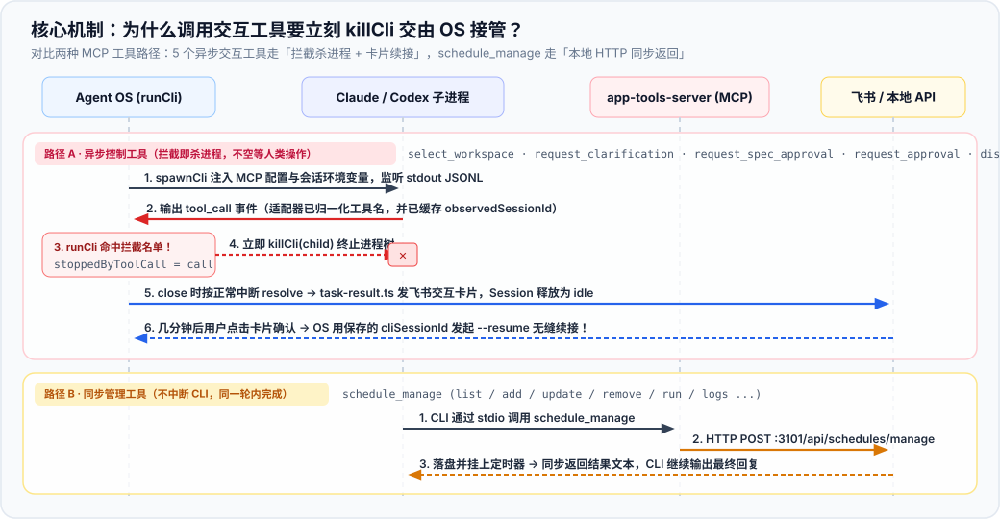

# 03. Claude / Codex 双引擎与 MCP 拦截

> **本章目标**：理解 Agent OS 最核心的技术设计——如何用统一接口同时驱动 `claude` 和 `codex` 两个 CLI，以及为什么内置 MCP Server 的大部分工具其实只是“空壳”，真正干活的是 `runCli` 的**工具调用拦截 + 进程终止机制**。

---

## 1. 整体结构：Adapter + Runner + MCP Server

`src/cli/` 与 `src/mcp/` 共同构成执行引擎层：

- `src/cli/types.ts`：定义 `CliAdapter` 接口与统一流式事件 `CliEvent`（`session`、`context`、`tool_start`、`tool_end`、`tool_call`、`stats`、`result`、`error`）。
- `src/cli/claude-adapter.ts` / `src/cli/codex-adapter.ts`：把各自的 CLI 参数构造、MCP 注入参数和 stdout JSONL 流式输出翻译成统一的 `CliEvent`。
- `src/cli/registry.ts`：按 `claude` / `codex` 注册并查找适配器。
- `src/cli/spawn-cli.ts`：跨平台子进程启动与进程树清理（`killCli`，兼容 Windows 下 `cmd` 外壳导致的孤儿进程问题）。
- `src/cli/runner.ts`：核心执行循环 `runCli()`——管理超时、取消信号、流式解析、**拦截关键工具调用**。
- `src/cli/app-tools.ts` + `src/mcp/app-tools-server.ts`：把 Agent OS 控制工具封装成 stdio MCP Server 注入给 CLI。

---

## 2. 如何给两个引擎动态注入内置 MCP Server？

看 `src/cli/app-tools.ts:20-61`：

1. **自动识别开发态与生产态**（`serverInvocation()`）：
   - 如果当前从 `.ts` 运行（`pnpm dev` / `tsx`），用 `node node_modules/tsx/dist/cli.mjs src/mcp/app-tools-server.ts` 启动 MCP Server。
   - 如果从编译后的 `.js` 运行（`node dist/index.js`），直接用 `node dist/mcp/app-tools-server.js` 启动。
2. **分别按引擎原生方式注入**：
   - **Claude Code**（`claudeAppToolArgs`）：通过 `--mcp-config '{"mcpServers":{"agent_os":{"type":"stdio",...}}}'` 注入。
   - **Codex**（`codexAppToolArgs`）：通过 `-c mcp_servers.agent_os.command=... -c mcp_servers.agent_os.args=...` 注入。
3. **环境变量传递会话上下文**（`src/app/cli-execution.ts:36`、`src/index.ts:464-467`）：
   启动 CLI 子进程时注入 `AGENT_OS_CHAT_ID`、`AGENT_OS_OWNER_OPEN_ID`、`AGENT_OS_SESSION_ID`、`AGENT_OS_WORKSPACE`，CLI 再把这些环境变量透传给它拉起的 MCP 子进程。

### 双引擎的工具名归一化

两个引擎在事件流里上报 MCP 工具的格式不同，适配器把它们统一归一化为标准的 `tool_call` 事件：

| 引擎 | 原始流式事件格式 | 适配器识别位置 | 归一化后的 `toolName` |
| --- | --- | --- | --- |
| Claude Code | `type: "assistant"` → `content[].name === "mcp__agent_os__<tool>"` | `src/cli/claude-adapter.ts:208-250` | `<tool>`（去掉 `mcp__agent_os__` 前缀） |
| Codex | `type: "item.started"` → `item.type === "mcp_tool_call" && item.server === "agent_os"` | `src/cli/codex-adapter.ts:184-202` | `item.tool` |

---

## 3. 最精妙的设计：为什么“拦住就杀进程”？

刚读 `src/mcp/app-tools-server.ts` 时你可能会疑惑：除了 `schedule_manage` 真的发了 HTTP 请求之外，另外 5 个工具（`select_workspace`、`request_clarification`、`request_spec_approval`、`request_approval`、`dispatch_task`）的 handler 几乎什么都没做，只返回了一句提示文本！

**原因在于 CLI 是同步长跑进程，而人类确认是异步的（可能几分钟甚至几小时后）**：
- 如果让 MCP 工具在子进程里一直 `await` 等待用户点飞书卡片，不但会一直占着一个 CLI 进程和内存，还容易触发 CLI 内部工具调用超时，甚至模型在工具返回后继续擅自往下执行危险操作。
- **Agent OS 的解法是把控制权收回到 OS 进程**：



核心代码就在 `src/cli/runner.ts:123-137` 和 `178-187`：

```ts
// 1. 监听到控制工具调用：立刻记录并杀掉子进程
if (
  !stoppedByToolCall
  && ([
    'select_workspace',
    'request_approval',
    'request_clarification',
    'request_spec_approval',
    'dispatch_task',
  ].includes(event.toolName) || stopToolNames.includes(event.toolName))
) {
  stoppedByToolCall = {
    toolUseId: event.toolUseId,
    toolName: event.toolName,
    input: event.input,
  };
  killCli(child);
}
```

```ts
// 2. 子进程关闭时：优先判定 stoppedByToolCall，作为合法中断返回给上层
if (stoppedByToolCall) {
  settled = true;
  finish();
  resolve({
    answer: observedAnswer ?? '',
    sessionId: observedSessionId,
    toolCalls: [stoppedByToolCall],
  });
  return;
}
```

> **为什么唯独 `schedule_manage` 不在拦截名单里？**
> 因为创建/列出/删除定时任务不需要暂停等待人类异步回调——它是一个同步操作，由 `app-tools-server.ts` 直接 POST 到 OS 本地 API `http://127.0.0.1:3101/api/schedules/manage`，拿到结果后返回给模型，模型在同一轮里就能直接给用户汇报创建结果！

---

## 4. 跨平台与稳定性细节

1. **Windows 下的 Prompt 传递**（`src/cli/runner.ts:60-79`）
   - 在 Windows 上，命令行参数过长或包含换行/引号极易在 `cmd.exe` 下转义出错或乱码，因此 `promptInputForPlatform('win32')` 返回 `'stdin'`，通过子进程标准输入写入 Prompt；macOS / Linux 则作为命令行参数传入后直接关闭 `stdin`。
2. **双保险超时与取消**（`src/cli/runner.ts:82, 100-103`）
   - 默认超时 2 小时（可通过 `CLI_TIMEOUT_MS` / `CLAUDE_TIMEOUT_MS` / `CODEX_TIMEOUT_MS` 覆盖）。
   - 除了传给 `spawn` 的 `signal` 外，还额外监听 `signal.addEventListener('abort', () => killCli(child))`，确保 Windows 下连带清理整个进程树而不留孤儿进程。
3. **保存 `observedSessionId`**（`src/cli/runner.ts:116-118`）
   - 即使子进程中途被 `killCli` 停止，只要前面已经收到过 `session` 事件，返回结果里就带有最新的 `sessionId`，后续卡片回调即可无缝 `resume` 原会话。

---

## 5. 以后想改哪里？

- **调整工具拦截清单**：看 `src/cli/runner.ts:127` 与 `src/app/task-result.ts:32-34`。
- **适配 Claude / Codex 新版本流式事件格式变化**：分别看 `src/cli/claude-adapter.ts` 和 `src/cli/codex-adapter.ts` 的 `parseEvents()`，并用 `pnpm probe:cli` 实测。
- **新增一个 OS 控制工具**：需要同步改动 4 处（详见第 08 章扩展清单）：Schema → `src/mcp/app-tools-server.ts` → `claude-adapter.ts` & `codex-adapter.ts` → `runner.ts` / `task-result.ts`。
