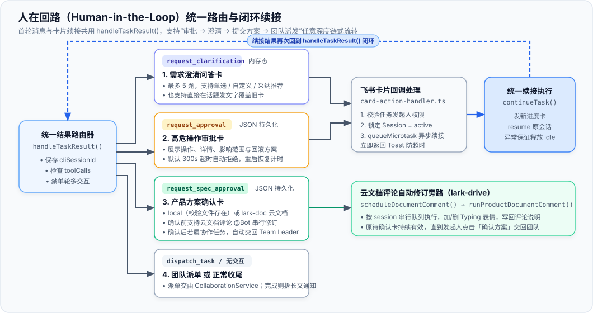
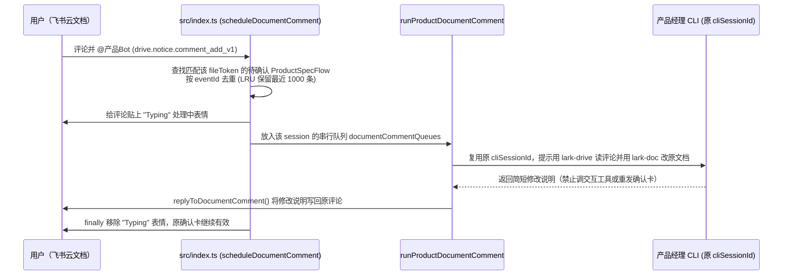

# 04. 人在回路状态机与卡片回调

> **本章目标**：看懂“首轮执行”和“卡片续接”如何复用同一套结果路由（`handleTaskResult`），以及澄清、审批、产品方案确认、云文档评论修订四条交互链路各自是怎么闭环的。

---

## 1. 统一结果路由器：`handleTaskResult()`

无论是**用户发首条消息**（`src/index.ts:521`），还是**用户点完卡片后继续执行**（`src/app/task-continuation.ts:53`），CLI 返回的结果都会经过同一个函数：`handleTaskResult(result, context)`（`src/app/task-result.ts:37-108`）。

这样做的好处是**任意深度链式交互天然成立**：
> 例如：模型首轮触发高危审批 → 用户点“放行”续接 → 续接中发现新歧义又触发澄清卡片 → 用户答完续接 → CEO 助理把任务 `dispatch_task` 派给开发。

---

## 2. 四条交互链路逐一拆解

所有卡片按钮回调都统一汇聚到 `src/app/card-action-handler.ts` 的 `createCardActionHandler()`，按 `action.value.action` 分发。

### 2.1 需求澄清链路（`request_clarification`）

- **数据结构**：`src/core/clarification.ts`（`ClarificationFlowStore`，内存存储）。一次最多 5 题，每题 2~4 个选项，支持 `recommendedOptionId`。
- **两种回答方式**（这是很容易忘的亮点！）：
  1. **在卡片上点选 / 输入自定义答案 / 一键采纳推荐**（`card-action-handler.ts:152-265`，`action === 'answer_clarification'`）：
     - 支持逐题作答（未答完时原地刷新卡片进入下一题），也支持点“采纳本题推荐”或“剩余全部采用推荐”（`decisionMode: 'current' | 'remaining'`）。
     - 全部答完后：把 Session 置为 `active`，删除 `clarificationFlow`，通过 `queueMicrotask` 异步调用 `continueClarificationFlow` → `continueTask` 续接原 CLI 会话，同时立刻返回“答案已收到”卡片响应给飞书（避免飞书卡片回调超时）。
  2. **直接在话题里发文字消息回复**（`src/index.ts:245-250, 284-288, 369-384`）：
     - 如果当前话题存在 `pendingClarification` 且用户发了普通消息（非斜杠命令），OS 会把用户消息用 `formatClarificationMessage` 包装成澄清回复喂给模型，删除旧流，并把旧澄清卡片更新为“已由新消息覆盖（Superseded）”。
- **权限控制**：仅任务发起人（`isClarificationOwner`）可点击卡片回答。

### 2.2 高危操作审批链路（`request_approval`）

- **数据结构与持久化**：`src/core/approval.ts` + `src/core/approval-store.ts`（落盘 `data/approval-flows.json`）。默认超时 `DEFAULT_APPROVAL_TIMEOUT_SECONDS = 300` 秒（可在请求参数中指定 `60~3600` 秒）。
- **审批流转**（`card-action-handler.ts:267-349`，`action === 'decide_approval'`）：
  - 点击放行/拒绝后，校验发起人身份与会话状态，检查是否已过 `expiresAt`。
  - 通过 `scheduleApprovalContinuation()` 锁定 Session 为 `active`，并异步调用 `continueApprovalFlow` → `continueTask`，将 `formatApprovalDecision(flow)`（明确告知“已批准请继续”或“已拒绝/超时请停止并汇报”）送回原 CLI 会话。
- **超时自动处理**（`src/app/task-result.ts:127-144`）：
  - `armApprovalTimeout` 创建 `setTimeout`（调用 `.unref()` 不阻塞进程退出）；如果到点时 Session 正忙，会每秒重试一次直到空闲，再把审批标为 `expired` 并自动续接通知模型停止操作。
  - 服务重启时在 `src/index.ts:746-749` 会为所有 `pending` 审批重新挂载超时器。

### 2.3 产品方案确认链路（`request_spec_approval`）

- **数据结构与持久化**：`src/core/product-spec.ts` + `src/core/product-spec-store.ts`（落盘 `data/product-spec-flows.json`）。
- **两种唯一权威产物模式**：
  - `deliveryMode: 'local'`：提交前 `assertProductSpecDocuments`（`src/app/product-spec-documents.ts`）会真实检查工作目录下 `specPath` 和 `ticketsPath` 文件是否存在，杜绝模型“编造路径”。
  - `deliveryMode: 'lark-doc'`：提交飞书云文档 `documentUrl`，提取 `fileToken` 以便关联后续评论事件。
- **用户点击确认后**（`card-action-handler.ts:67-150`，`action === 'approve_product_spec'`）：
  - 将流程标为 `approved`。
  - **关键联动**：如果该方案是在多角色协作中由产品经理产出的（`approved.collaboration` 存在），OS 会自动调用 `collaborationService.dispatch()` 把已确认的方案标题、摘要、文档链接/路径和确认时间**直接交回 `reportToBotId`（通常是 CEO 助理）**，由它继续派给 `developer` 实现！

### 2.4 飞书云文档评论修订链路（`product-comment-runner.ts`）

针对 `lark-doc` 模式的产品方案，在用户点“确认方案”之前，可以直接在飞书云文档里划词评论 `@产品Bot` 提修改意见：

### 2.5 停止任务与历史会话切换卡片
- `action === 'abort_task'`（`card-action-handler.ts:402-421`）：调用 `requestTaskAbort`，仅允许任务发起人中止，触发 `AbortController.abort()` 进而 `killCli` 杀掉子进程。
- `action === 'resume_cli_session'`（`card-action-handler.ts:351-400`）：校验目标历史会话确实属于当前工作目录后，更新 `session.cliSessionId` 并刷新选择卡片。

---

## 3. 续接的容错设计（`src/app/task-continuation.ts`）

看 `continueTask()` 的 `try / catch / finally` 结构（第 25–81 行），有两点非常值得注意：
1. **卡片发送失败也不锁死会话**：如果首张进度卡片 `bot.replyCard` 抛错，`finally` 依然会清理 `activeRuns` 并调用 `markSessionIdle`，不会让 Session 永久卡在 `active`。
2. **避免 `queueMicrotask` 阻塞飞书回调**：飞书要求卡片动作回调尽快返回响应，因此所有耗时的 CLI 续接都先同步锁定 Session 状态，再通过 `queueMicrotask` 丢到后台跑，卡片回调立刻返回“已收到/已放行”的 Toast 和过渡态卡片。

---

## 4. 以后想改哪里？

- **调整审批默认超时时长**：修改 `src/core/approval.ts:5` 的 `DEFAULT_APPROVAL_TIMEOUT_SECONDS`。
- **定制卡片文案与样式**：集中在 `src/im/card.ts`（1310 行，纯卡片构建函数，改文案和布局不影响业务逻辑）。
- **让澄清流程支持重启恢复**：把 `ClarificationFlowStore` 参照 `JsonApprovalFlowStore` 加上 JSON 持久化即可。
