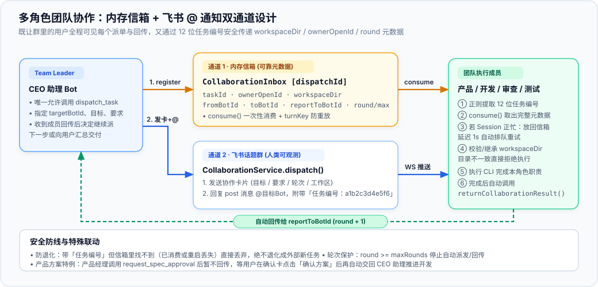

# 05. 多角色团队协作与消息编排

> **本章目标**：理解多个飞书 Bot 如何在同一个话题里真实互相 `@` 协作，为什么需要 `CollaborationInbox` + 任务编号，以及目录继承、轮次上限、忙时排队与自动回传是如何配合工作的。

---

## 1. 团队花名册与角色边界（`src/core/team-registry.ts`）

启动时 `TeamRegistry` 根据 `config/bots.json` 构建全员名单，并在每次调用 CLI 前通过 `teamRegistry.contextFor(currentBotId)`（第 37–55 行）把团队花名册注入到该角色的 Prompt 中：

- 告诉模型团队里有哪些长期成员（`id`、职责 `role`、绑定的 `skills`），以及谁是 `Team Leader`。
- 明确区分 **长期飞书 Bot 成员** 与 **CLI 内部临时 Sub-Agent**：不能在内部冒充团队成员，真正跨角色交接必须调用 `dispatch_task`。
- **硬权限校验**（`src/app/task-result.ts:89-90`）：虽然 Prompt 里有约定，但 OS 运行时也会强制拦截——**只有 `teamLeader` 可以调用 `dispatch_task`**，且不能派给自己，违规直接抛错。

---

## 2. 一次完整的协作闭环（CEO 助理 → 成员 → 自动回传）

为什么协作派单不直接用内存函数调用，而是真的在飞书群里发一张协作卡片再 `@目标Bot`？
因为**话题本身就是人机共享的可观测工作台**——群里的你可以清楚看到谁在什么时候把什么要求交给了谁，又能继续在同一个话题里插话、审批或确认。

同时为了保证**结构化元数据不丢失**（如 `taskId`、`ownerOpenId`、`workspaceDir`、`round`、`reportToBotId`），OS 采用了 **「内存信箱 + 飞书消息携带 12 位任务编号」** 的双通道设计：

---

## 3. 核心源码拆解与防踩坑机制

协作接收逻辑集中在 `src/index.ts:186-226`、`343-351`、`386-396`，协作发送在 `src/app/collaboration-service.ts`，结果回传在 `src/app/task-result.ts:110-124`。

### 3.1 防重放与防退化（`src/index.ts:186-226`）
当一个 Bot 收到 `senderType === 'app' || senderType === 'bot'` 的消息时，分 4 种情况处理：
1. **未 `@` 当前 Bot**：直接忽略（防止同群多个机器人互相触发风暴）。
2. **包含 `任务编号：<12位hex>` 且在 `collaborationInbox` 命中**：
   - `consume(dispatchId, config.id)` 一次性消费并验证 `toBotId`。
   - 检查 `processedCollaborationTurns`（键为 `${taskId}:${round}:${toBotId}`）防止飞书事件重复投递导致同一轮执行两次。
3. **包含 `任务编号` 但信箱里没有（已被消费或服务重启丢失）**：直接 `return`！源码注释明确写了：`已消费或过期的协作通知不能退化为新的外部任务`。
4. **被 `@` 且不含 `任务编号`**：视为外部 Bot 派活，使用 `process.env.OWNER_OPEN_ID ?? msg.senderOpenId` 作为归属人继续处理。

### 3.2 发送失败自动回滚信箱（`src/app/collaboration-service.ts:114-120`）
如果发协作卡片或 `@` 消息调用飞书接口抛错，`catch` 块会立刻 `collaborationInbox.consume(...)` 清理刚注册的条目，避免内存泄漏或残留脏任务。

### 3.3 目标 Bot 正忙时自动排队重试（`src/index.ts:343-351`）
如果开发 Bot 此时正处于 `active` 状态（例如上一轮还没结束，或正在处理另一个派单）：
- 把刚刚消费出来的 `collaboration` 重新放回 `collaborationInbox`，从 `processedCollaborationTurns` 移除当前 turnKey；
- 用 `setTimeout(..., 1000)` 延迟 1 秒重新投递给 `handleMessage(msg, bot)`，直到目标会话空闲再接单。

### 3.4 工作目录一致性校验（`src/index.ts:386-396`）
- 如果接收方 Session 尚未绑定目录，且协作消息带有 `workspaceDir`：验证目录存在后自动为该话题绑定。
- 如果接收方 Session **已经绑定了另一个不同目录**：直接抛错拒绝（`协作任务的目录与当前话题不一致，请重新派发`），避免过时派单改错项目代码。

### 3.5 自动回传与产品方案确认联动
- **普通执行完成自动回传**（`src/app/task-result.ts:110-124`）：只要当前任务带有 `collaboration` 来源、当前角色不是 `reportToBotId`、且 `round < maxRounds`，就会自动调用 `CollaborationService.dispatch` 把执行结果交回 `reportToBotId`（轮次 `round + 1`）。
- **产品方案确认后自动交回**（`src/app/card-action-handler.ts:100-142`）：产品经理提交 `request_spec_approval` 后并不会立即回传，而是等用户在确认卡上点击**确认通过**后，才由卡片回调把已确认方案与链接交回 CEO 助理继续派给开发。

---

## 4. 以后想改哪里？

- **允许其他角色也能互相派单（不只限 CEO 助理）**：修改 `src/app/task-result.ts:89` 的权限判断，并同步更新 `src/core/team-registry.ts:52` 与 `src/mcp/app-tools-server.ts:130` 的提示说明。
- **调整协作轮次上限**：在 `config/bots.json` 中修改对应角色的 `collaborationMaxRounds`（最大 32，校验在 `src/core/bot-registry.ts:47`）。
- **让待接收协作队列支持重启恢复**：将 `CollaborationInbox`（`src/core/collaboration.ts:77-93`）改为持久化 Store。
