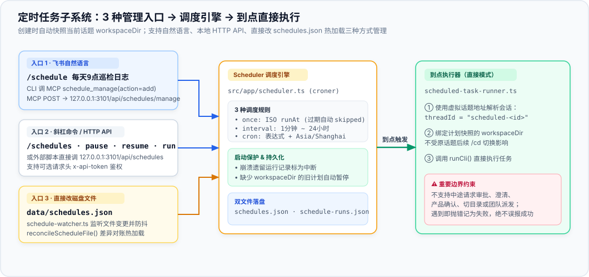
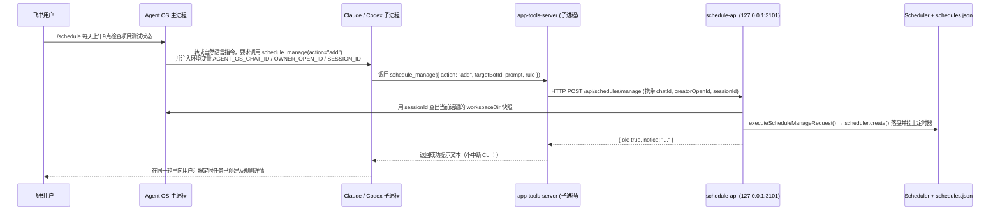

# 06. 定时任务调度、热加载与本地 HTTP API

> **本章目标**：理解用户的一句 `/schedule 每小时检查日志` 是如何穿过 MCP Server 和本地 3101 端口变成持久化定时任务的，以及调度器、文件热加载和定时执行器之间的协作与限制。

> **用大白话理解**：你可以把它看成一个带“自然语言闹钟面板”的 Cron 调度器。你用大白话跟机器人说什么时候干什么，模型通过 MCP 悄悄调用本机 `127.0.0.1:3101` 把计划记进 `data/schedules.json`；你也可以直接手动改这个 JSON 文件，系统监听到文件变动会自动热更新闹钟。到点后系统直接派对应机器人干活，但为了防止半夜无人值守卡死，闹钟任务不支持中途弹卡片等你点按钮。



---

## 1. 模块全景

定时任务子系统由 7 个文件组成，职责拆得很干净：

| 文件 | 职责 |
| --- | --- |
| `src/core/schedule.ts` | 数据结构与 Zod Schema：3 种规则（`once` / `interval` / `cron`）及 11 种管理动作 |
| `src/core/schedule-store.ts` | 计划列表持久化（`data/schedules.json`） |
| `src/core/schedule-run-store.ts` | 执行历史持久化（`data/schedule-runs.json`，记录成功/失败/跳过/中断） |
| `src/app/scheduler.ts` | 定时器调度引擎（基于 `croner` + `setTimeout`，处理启动恢复、防重入、下次触发计算） |
| `src/app/schedule-manage-service.ts` | 统一执行 `list / add / addMany / update / remove / removeMany / removeAll / run / pause / resume / logs` |
| `src/app/schedule-api.ts` | 监听 `127.0.0.1:3101` 的本地 HTTP 管理接口 |
| `src/app/schedule-watcher.ts` | 监听 `data/schedules.json` 文件变更并做差异对账热加载 |
| `src/app/scheduled-task-runner.ts` | 定时到点后的真实 CLI 执行器（直接执行模式） |

---

## 2. 为什么 MCP 管理定时任务要走本地 HTTP API？

回顾第 03 章：`app-tools-server.ts` 是由 `claude` / `codex` 拉起的**独立子进程**，它和 Agent OS 主进程**不共享内存**（拿不到主进程里的 `Scheduler` 实例和内存 `timers`）。

因此 Agent OS 设计了一条优雅的跨进程回环链路：



> **核心细节**：API 收到 `sessionId` 后会校验该会话是否属于当前 `chatId` 且未关闭（`src/app/schedule-api.ts:59-62`），然后自动取 `session.workspaceDir` 作为该计划的目录快照。

---

## 3. 调度引擎的 4 个核心机制（`src/app/scheduler.ts`）

### 3.1 三种调度规则（`src/core/schedule.ts:4-18`）
- **`once`**：ISO 时间戳 `runAt`（如果重启时已经错过时间，启动阶段会记一条 `skipped` 运行记录并把任务标为 `completed`，不会补跑历史过期一次性任务）。
- **`interval`**：固定毫秒间隔 `everyMs`（限制在 `1 分钟 ~ 24 小时` 之间）。
- **`cron`**：标准 Cron 表达式 + `timezone`（默认 `Asia/Shanghai`），由 `croner` 计算下一次触发时刻。

### 3.2 崩溃恢复与旧计划迁移（`src/app/scheduler.ts:22-46`）
启动 `scheduler.start()` 时做两件事：
1. `recoverInterruptedRuns()`：扫描 `schedule-runs.json`，把上次进程异常退出时仍停留在运行中的记录标记为中断。
2. 遍历 `schedules.json`：如果遇到历史遗留的、没有 `workspaceDir` 字段（`undefined`）的计划，**自动暂停**并打印告警，绝不猜测或回退到 OS 目录。

### 3.3 文件热加载对账（`src/app/schedule-watcher.ts`）
`startScheduleFileWatcher` 用 `fs.watchFile` 监控 `data/schedules.json`：
- 你在磁盘上手动编辑 `schedules.json`（比如给暂停的旧计划补上 `workspaceDir` 并把 `status` 改为 `"active"`）后，防抖触发 `reconcileScheduleFile()`。
- 它会逐条比对 `chatId / creatorOpenId / targetBotId / workspaceDir / prompt / rule / status` 7 个核心字段，自动完成新增、更新、删除并重算定时器，无需重启服务。

### 3.4 定时执行器为什么禁止中途交互？（`src/app/scheduled-task-runner.ts`）
定时任务在后台无人值守触发，使用独立的虚拟话题地址 `threadId: "scheduled-<task.id>"` 解析会话并调用 `runCli`。

看第 77 行：
```ts
if (result.toolCalls?.some(call => [
  'select_workspace',
  'request_clarification',
  'request_approval',
  'request_spec_approval',
  'dispatch_task',
].includes(call.toolName))) {
  throw new Error('定时任务请求了交互或团队派发，当前直接执行模式无法处理，请调整计划后重试');
}
```
**设计取舍**：
- 定时任务没有对应的“人发出的原始飞书消息 ID”去挂交互卡片，也不适合在半夜自动触发一连串未确认审批或团队派单。
- 因此目前定位为**直接执行模式**（适合巡检、日报汇总、直接推送通知类任务）；如果模型触发了交互或派发工具，直接抛错记入 `schedule-runs.json` 失败日志，避免静默丢任务或误报成功。

---

## 4. 以后想改哪里？

- **开放远程调用本地管理 API**：目前 `schedule-api.ts:101` 写死了监听 `127.0.0.1`（只允许本机访问），如需跨机调用请务必先配置 `SCHEDULE_API_TOKEN`。
- **给定时任务增加执行结果自动发飞书卡片**：在 `src/app/scheduled-task-runner.ts` 拿到 `result.answer` 后，通过 `runtime.botRuntimes.get(task.targetBotId)?.bot.sendCardToChat(task.chatId, ...)` 发送即可（目前是靠 Prompt 让模型按需自行推送）。
- **放宽 `interval` 最小/最大间隔**：修改 `src/core/schedule.ts:11` 的 `min(60_000).max(24 * 60 * 60 * 1000)`。
