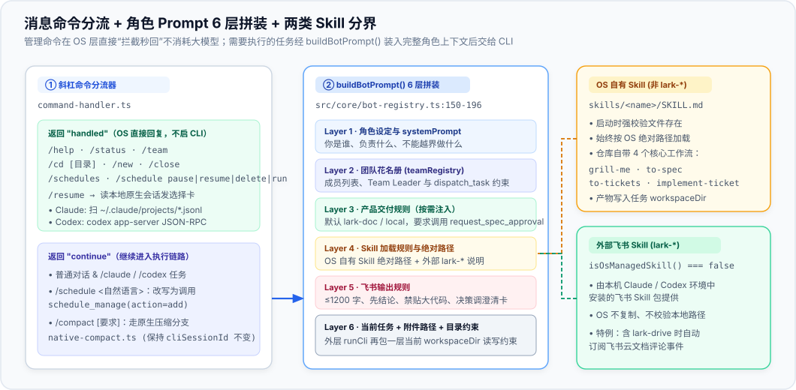
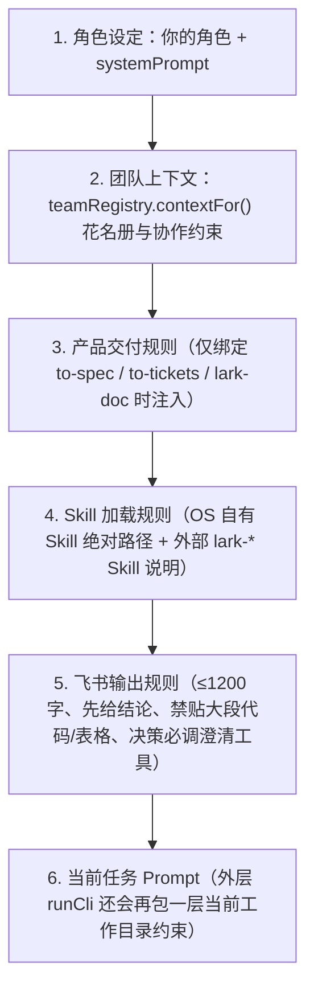

# 07. 斜杠命令、原生会话与 Skill 体系

> **本章目标**：理清飞书里输入的斜杠命令如何分流，`/resume` 和 `/compact` 在 Claude Code 与 Codex 两个引擎下截然不同的底层实现，以及 Agent OS 如何拼接角色 Prompt 与加载 Skill。

> **用大白话理解**：发给机器人的消息分两类——带 `/` 的管理指令（如 `/cd`、`/team`、`/resume`）由 OS 前台直接秒回，既快又不花 Token；真正要干活的任务，OS 会先帮机器人穿好“工服”（把岗位职责、团队名单、工作流 Skill 说明书、飞书字数要求按 6 层拼好），再交给 Claude 或 Codex 执行。



---

## 1. 命令解析与分流（`command-parser.ts` & `command-handler.ts`）

每条飞书消息进来后，`src/index.ts:235-236` 会先后做两次轻量解析：
1. `parseCommand(resolved)`：解析管理型斜杠命令（`/help`、`/status`、`/team`、`/cd`、`/new`、`/resume`、`/compact`、`/close`、`/schedules`、`/schedule ...`）。
2. `parseCliRequest(resolved)`：解析引擎选择前缀（`/claude <任务>`、`/codex <任务>`）。

随后交给 `handleSessionCommand()`（`src/app/command-handler.ts`），返回值只有两种：
- **`"handled"`**：命令已经处理并回复完毕（如 `/help`、`/status`、`/team`、`/cd`、`/new`、`/resume`、`/schedules`、`/schedule pause|resume|delete|run`、`/close`），直接 `return`，**不会启动 CLI**。
- **`"continue"`**：需要继续往下走主执行流程，主要包括：
  - 普通对话与 `/claude`、`/codex` 任务；
  - `/schedule <自然语言需求>`（已被改写成调用 `schedule_manage` 的任务 Prompt）；
  - `/compact [要求]`（在 `src/index.ts:470-482` 走专门的原生压缩分支 `compactCliSession`）。

---

## 2. 原生会话列表 `/resume`（`src/cli/native-sessions.ts`）

`/resume` 让你可以在飞书里把某个话题切回你之前在终端/IDE 或旧话题里跑过的原生 CLI 会话（最多列出最近 8 条，`SESSION_LIMIT = 8`）。

因为 Claude Code 和 Codex 的存储方式完全不同，`listNativeCliSessions` 做了两套截然不同的读取实现：

| 引擎 | 底层实现方式 | 核心函数 | 筛选条件 |
| --- | --- | --- | --- |
| **Claude Code** | 直接扫描磁盘 JSONL：`~/.claude/projects/<cwd-key>/*.jsonl`（可通过 `CLAUDE_CONFIG_DIR` 覆盖），逐行解析 `sessionId`、`cwd`、`ai-title`、`last-prompt` 和首条 `user` 消息 | `listClaudeSessions`（第 51–119 行） | `observedCwd === session.workspaceDir` |
| **Codex** | 启动 `codex app-server --stdio` 子进程，通过 stdin/stdout 走 **JSON-RPC** 握手：`initialize` → `initialized` → `thread/list`（带 `cwd`、`limit: 8`、`sortKey: 'updated_at'`） | `listCodexSessions`（第 122–225 行） | 由 `app-server` 按 `cwd` 过滤，来源覆盖 `cli / vscode / exec / appServer` |

点击卡片里的某条历史会话后，`card-action-handler.ts:351-400` 会再次校验该会话确实属于当前 `workspaceDir`，然后调用 `sessions.setCliSessionId(session.id, cliSessionId)` 完成绑定。

---

## 3. 原生上下文整理 `/compact`（`src/cli/native-compact.ts`）

当长话题的上下文快满时，`/compact [压缩重点]` 不会自己写一段总结 Prompt 糊弄，而是**直接调用两个 CLI 各自的原生压缩协议**，保持 `cliSessionId` 不变：

- **Claude Code**（`protocol: 'claude-stream-json'`）：用 `--resume <sessionId>` 启动 Claude，通过 stdin 写入 `/compact <instructions>` 并关闭 stdin，监听流式事件直到原生压缩完成。
- **Codex**（`protocol: 'codex-app-server'`）：拉起 `codex app-server --stdio`，通过 JSON-RPC 协议对目标 `threadId` 发起原生压缩请求（Codex 原生压缩走默认策略，卡片也会提示用户这一点）。

---

## 4. 角色 Prompt 拼接与 Skill 体系（`src/core/bot-registry.ts`）

每次真正执行 CLI 前，`executeCli` 和 `runScheduledTaskDirectly` 都会调用 `buildBotPrompt()`（`src/core/bot-registry.ts:150-196`），把一段完整的运行时上下文按固定顺序拼装出来：



### 两类 Skill 的分界线

在 `src/core/bot-registry.ts:146-148` 里只有一行非常明确的区分逻辑：

```ts
export function isOsManagedSkill(skill: string): boolean {
  return !skill.startsWith('lark-');
}
```

1. **OS 自有 Skill**（非 `lark-` 开头）：
   - 位于仓库 `skills/<name>/SKILL.md`，启动时 `teamRegistry.findMissingSkills()` 强校验存在性。
   - Prompt 中强制给出绝对路径，避免被用户项目里同名文件干扰；但要求交付产物写入**任务工作目录**。
   - 仓库自带 4 个核心 Skill：
     - `grill-me`：先识别关键歧义并强制通过 `request_clarification` 发卡片澄清，不写代码。
     - `to-spec`：把讨论沉淀为本地产品 Spec。
     - `to-tickets`：将方案拆解为带阻塞依赖的纵向切片 Tickets。
     - `implement-ticket`：按确认方案实现代码，并串联基础验证 → Tester 验收 → Code Reviewer 审查。
2. **外部飞书 Skill**（`lark-*` 开头，如 `lark-doc`、`lark-drive`）：
   - 由宿主机 Claude Code / Codex 环境中安装的飞书 Skill 包提供，Agent OS 不做本地路径检查，只在 Prompt 中指示模型按引擎方式调用。
   - 特例：角色配置了 `lark-drive` 时，Agent OS 会自动额外开启飞书云文档评论监听（见第 04 章）。

---

## 5. 以后想改哪里？

- **调整飞书回复字数/格式约束**：改 `src/core/bot-registry.ts:170-176` 的 `feishuOutputPolicy`。
- **修改 `/resume` 显示的历史会话条数**：改 `src/cli/native-sessions.ts:9` 的 `SESSION_LIMIT`。
- **新增一个 OS 自有 Skill**：在 `skills/<your-skill>/SKILL.md` 建文件，再把它加到 `config/bots.json` 对应角色的 `skills` 数组中即可。
