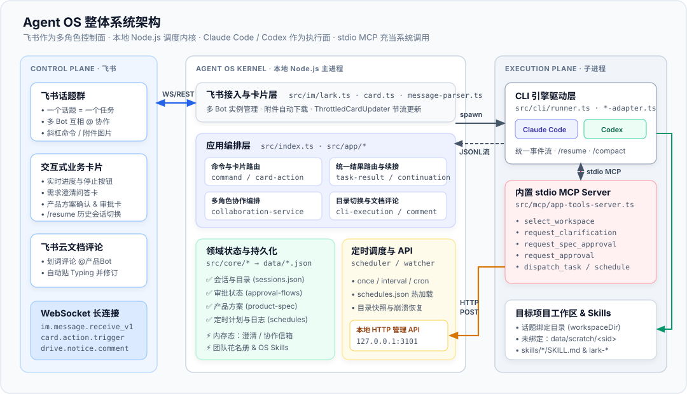

# Agent OS 源码学习手册

欢迎来到 **Agent OS** 源码学习 Wiki。这套手册面向“过几个月回头看代码可能会忘”的真实场景：**先讲设计动机与数据流，再指路到精确的文件与函数**，帮你快速把业务心智和源码实现重新对齐。

---

## 一句话理解 Agent OS

> **Agent OS 是一个运行在本机的调度内核**：它把飞书话题群变成控制面，把本机的 `claude` / `codex` CLI 变成执行面，并用一个内置的 stdio MCP Server 充当“系统调用接口（syscall）”，让 AI 模型能向 OS 发起选目录、提问澄清、提交方案、请求审批、团队派单与定时任务管理。



如果用操作系统来类比：

| 操作系统概念 | Agent OS 对应实现 | 核心代码位置 |
| --- | --- | --- |
| 终端 / GUI | 飞书话题群 + 交互卡片 + 云文档评论 | `src/im/lark.ts`, `src/im/card.ts` |
| 进程 / 执行引擎 | `claude` / `codex` CLI 子进程 | `src/cli/runner.ts`, `src/cli/*-adapter.ts` |
| 系统调用（Syscall） | 内置 MCP Server 暴露的 6 个控制工具 | `src/mcp/app-tools-server.ts` |
| 进程表 / 上下文 | 按 `(botId, chatId, threadId)` 隔离的 Session | `src/core/session-manager.ts` |
| 工作目录（CWD） | 话题级共享的 `workspaceDir` | `src/core/workspace.ts` |
| 定时作业（Cron） | 调度器 + 文件监听 + 本地 HTTP API | `src/app/scheduler.ts`, `src/app/schedule-api.ts` |

---

## 推荐阅读路线

根据你当前的目标，按不同顺序阅读效率最高：

### 路线 A：很久没看代码，15 分钟恢复全局记忆
1. [01. 整体架构与启动全流程](01-architecture.md) — 先看全景图与 `src/index.ts` 启动顺序
2. [03. Claude / Codex 双引擎与 MCP 拦截](03-cli-engines-and-mcp.md) — 掌握最核心的“工具调用即杀子进程、OS 接管”机制
3. [04. 人在回路状态机与卡片回调](04-human-in-the-loop.md) — 看懂任务暂停与续接的闭环

### 路线 B：从头精读全量源码（循序渐进）
直接按左侧目录 `01` → `08` 顺序阅读，每章都配有 Mermaid 流程图、精确文件/行号索引和“以后想改哪里”的入口清单。

### 路线 C：带着问题查代码（速查索引）

| 你想了解 / 修改什么 | 直接看哪一章 | 核心文件 |
| --- | --- | --- |
| 新话题是怎么绑定和切换项目目录的？ | [第 02 章](02-feishu-and-session.md) | `src/core/session-manager.ts`, `src/app/cli-execution.ts` |
| 为什么调完审批/澄清工具模型就不会继续瞎跑了？ | [第 03 章](03-cli-engines-and-mcp.md) | `src/cli/runner.ts`, `src/mcp/app-tools-server.ts` |
| 点击飞书卡片按钮后如何恢复 CLI 会话继续跑？ | [第 04 章](04-human-in-the-loop.md) | `src/app/card-action-handler.ts`, `src/app/task-continuation.ts` |
| CEO 助理如何把任务派给开发，完成后又怎么回来？ | [第 05 章](05-multi-agent-collaboration.md) | `src/app/collaboration-service.ts`, `src/index.ts` |
| 定时任务为什么会经由本地 3101 端口？ | [第 06 章](06-scheduler-and-api.md) | `src/mcp/app-tools-server.ts`, `src/app/schedule-api.ts` |
| `/resume` 和 `/compact` 底层是怎么实现的？ | [第 07 章](07-skills-and-commands.md) | `src/cli/native-sessions.ts`, `src/cli/native-compact.ts` |
| 如何新增一个 MCP 工具、斜杠命令或 CLI 引擎？ | [第 08 章](08-testing-and-extension.md) | `tests/chains.test.ts`, `tests/workspace.test.ts` |

---

## 源码模块总览

全仓业务源码约 8,750 行 TypeScript，按职责严格分层：

```text
src/
├── index.ts                 # 主入口：装配运行时、启动多 Bot、挂载调度器与本地 API
├── deploy-cli.ts            # 本地 PM2 运维脚手架（pnpm agent-os ...）
├── probe-cli.ts             # CLI 协议独立探测脚本
├── probe-app-tool.ts        # MCP 工具独立探测脚本
├── core/                    # 纯领域模型、Zod Schema 与 JSON 持久化（不依赖飞书或 CLI 进程）
├── im/                      # 飞书 WebSocket/REST 适配、消息解析、卡片 JSON 构造与节流更新
├── cli/                     # Claude / Codex 子进程封装、事件解析、原生会话与原生压缩
├── mcp/                     # 独立进程运行的 stdio MCP Server（向 CLI 暴露 OS 控制工具）
└── app/                     # 应用编排层：串联 core + im + cli，驱动业务全链路
```

---

## 本地预览与 GitHub Pages 部署

本 Wiki 基于 **Docsify**（零构建、纯静态 Markdown），支持三种阅读方式：

1. **GitHub 仓库直接看**：在 GitHub 或 VS Code 中直接打开 `docs/*.md` 即可正常阅读。
2. **本地启动 Wiki 预览**：
   ```sh
   # 方式一：使用 Python 内置静态服务器（零安装）
   python3 -m http.server -d docs 3000

   # 方式二：使用 docsify-cli
   npx docsify-cli serve docs
   ```
   浏览器打开 `http://localhost:3000`。
3. **GitHub Pages 一键发布（零构建）**：
   - 在 GitHub 仓库打开 **Settings → Pages → Build and deployment**。
   - **Source** 选择 **Deploy from a branch**，分支选 **`main`**，目录选 **`/docs`**，点击 **Save**。
   - 目录下已内置 `.nojekyll`，推送到 `main` 后会自动发布到 `https://th1humble.github.io/agentos/`。
